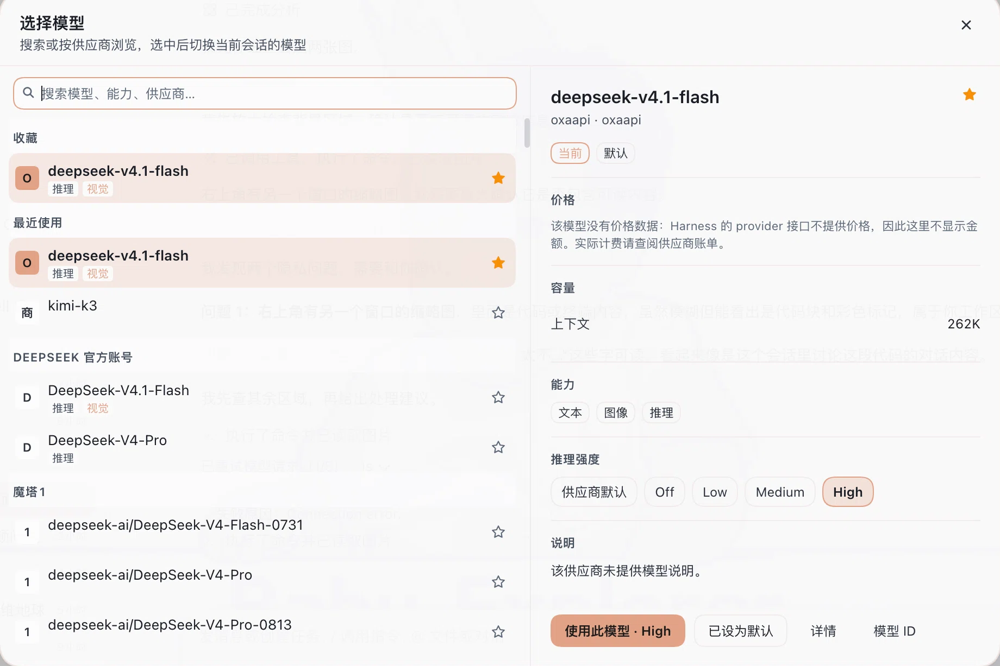

# dsh-model-picker

A two-pane model picker for [DeepSeek Harness](https://github.com/deepseek-ai/deepseek-harness). It replaces the model menu that the composer opens from the model pill — a long drilled list you have to click through provider by provider — with one dialog: every model searchable on the left, everything known about the selected one on the right.



中文说明见下方 [中文](#中文)。

---

## What it changes

The composer's model seat (`conversation.input.model`) normally opens the shipped drilled menu: a search field, then one folder per provider that you step into and back out of, one model at a time. This plugin takes that seat over at a lower slot priority and renders its own picker instead:

| Before | After |
|---|---|
| A drilled list; you open a provider, pick, and go back for another | One dialog with every provider visible at once |
| Only the model name per row | Provider, name, capability tags and favorites together |
| Nothing about the model itself | Capacity, capabilities, reasoning levels and actions on the right |
| No favorites or recents | Both pinned above the provider groups |

The trigger keeps its place in the tool row and still shows the current model name; only what it opens changes.

**Left pane**

- Search across model names, provider names and capability tags.
- Grouped list: favorites, recently used, then one group per provider.
- Each row shows a provider initial, the model name, its capability tags, and a star.
- Keyboard: `↑` / `↓` to move, `Enter` to apply, `Esc` to close.

**Right pane**

- Model name with a favorite star, and `provider · providerId` underneath.
- Capacity: context window and output cap.
- Capabilities: text / image input, reasoning.
- Reasoning effort chips, when the model declares levels.
- Description.
- Actions: apply to this session, set as deployment default, details, model ID.

Favorites and recents are stored on the Host, so they survive reloads and are shared by every window.

## Where the data comes from

Every value is whatever the model's own provider reports through the Harness `llm` service — `llm.listModels()` and `llm.resolveModelInfo()`. Nothing is inferred, and no second source is consulted.

That has one consequence worth stating plainly: **no price is shown.** Harness's provider interface exposes no cost field at all — its own adapter source says "the harness never reads pi-ai's cost metadata" — so there is nothing truthful to display under "price". Rather than borrow a list price from some other vendor that happens to sell a model with the same name, the detail card explains that the model carries no price data. If you need actual rates, use your provider's invoice.

The same rule applies to capacity. A context window or output cap appears only when the route or its model entry declares one; an undeclared model shows no number instead of a guessed default.

Capability tags follow your configuration. A model declared with `input: [text, image]` shows `visual`; a model declared with only `id` and `name` shows text, because that is what the schema's `DEFAULT_INPUT` reports. If a model supports images but shows text, add the declaration to your provider configuration.

## Install

Install it into a Harness profile as a bundle:

```bash
# from your Harness project, with this package published or linked locally
pnpm add dsh-model-picker
```

Then add `dsh-model-picker` to `dsh.profile.bundles` in your profile's `package.json`, or install it through the in-app plugin manager, which writes that entry for you. Reload the page once after installing.

For local development, link the directory instead of publishing:

```bash
pnpm add link:/absolute/path/to/dsh-model-picker
```

## Requirements

- A DeepSeek Harness install with the Web client.
- The shipped `@deepseek-ai/dsh-client-ui-model-selection` package, which provides the `modelDirectories` Client service this picker reads its model list from. Without it the plugin stays dormant and the stock menu renders.

## Configuration

None. The plugin has no options: it reads the provider catalog Harness already resolved, and stores its own preferences under `$DSH_HOME/model-picker/` (default `~/.dsh/model-picker/`).

| File | Contents |
|---|---|
| `model-picker-prefs.json` | Favorites and the last 12 recently used models |
| `client-errors.log` | Client-side crash reports, written only if the picker throws |

Deleting the directory resets favorites and recents.

## Hot reload

The UI half (`client.js`) is hot-reloaded by the shipped `dsh-client-hmr` transport: save the file and the open page swaps the plugin in about a second, no restart. The Host half (`index.js`) is a Node plugin and needs an app restart.

## Development

The package is plain ES modules — no build step, no bundler, no client package imports. Two entry points:

- `index.js` — Host half. Registers the `/api/model-picker/*` routes (`meta`, `prefs`, `report`, `default`), all fenced to loopback callers.
- `client.js` — Client half. Registers the seat over the `conversation.input.model` slot and draws the dialog.

The browser half is loaded through `window.__ModuleLoader__.load({ id, factory })` and may only `require` `react`, `react-dom` and `react/jsx-runtime`.

---

## 中文

把 DeepSeek Harness 输入框旁的模型菜单换成双栏选择器。原本要逐个供应商点进去再退出来的多层列表，变成一次打开就能看全的对话框：左侧是所有模型，右侧是选中模型的全部已知信息。


### 改了什么

输入框的模型位置（`conversation.input.model`）原本打开官方那个多层下拉：一个搜索框，然后是每个供应商一个文件夹，要逐个点进去、再退出来。

本插件以更低的槽位优先级接管该位置，改为渲染自己的选择器：

| 之前 | 之后 |
|---|---|
| 多层下钻，进一个供应商、选一个、再退出来 | 一个对话框，所有供应商同时可见 |
| 每行只有模型名 | 供应商、模型名、能力标签、收藏星标同屏 |
| 看不到模型本身的任何信息 | 右栏给出容量、能力、推理档位与操作 |
| 没有收藏和最近使用 | 两者都置顶在供应商分组之前 |

触发器仍在工具行原位、仍显示当前模型名，只是点开后的内容变了。

**左栏**

- 跨模型名、供应商名、能力标签搜索。
- 分组列表：收藏、最近使用，之后是每个供应商一组。
- 每行显示供应商首字母、模型名、能力标签和星标。
- 键盘：`↑` / `↓` 移动，`Enter` 应用，`Esc` 关闭。

**右栏**

- 模型名与收藏星标，下方是 `供应商 · 供应商 ID`。
- 容量：上下文窗口、最大输出。
- 能力：文本 / 图像输入、推理。
- 模型声明了推理档位时，显示档位按钮。
- 说明文字。
- 操作：使用此模型、设为默认、详情、模型 ID。

收藏与最近使用存放在 Host 侧，重载后仍在，多个窗口共享。

### 数据来自哪里

所有数值都是该模型所属供应商通过 Harness 的 `llm` 服务（`llm.listModels()` 与 `llm.resolveModelInfo()`）报告的内容。不做推断，也不读第二个数据源。

由此有一个必须说清的结论：**不显示价格。** Harness 的供应商接口根本没有价格字段——它自己的适配器源码里写着 "the harness never reads pi-ai's cost metadata"——所以「价格」一栏没有真实内容可填。与其借用另一家恰好同名模型的价目，详情页直接说明该模型没有价格数据。要看真实费率请查阅供应商账单。

容量同理：只有在路由或模型条目显式声明时才显示上下文和输出上限，未声明就留空，而不是填一个猜测的默认值。

能力标签跟随你的配置。声明了 `input: [text, image]` 的模型显示「视觉」；只写了 `id` 和 `name` 的模型显示「文本」，因为 schema 的 `DEFAULT_INPUT` 就是如此。若某模型实际支持图像但显示为文本，在供应商配置里补上声明即可。

### 安装

作为 bundle 装进 Harness profile：

```bash
pnpm add dsh-model-picker
```

然后把 `dsh-model-picker` 加入 profile `package.json` 的 `dsh.profile.bundles`，或直接用应用内的插件管理器安装（它会替你写入该条目）。安装后重载页面一次。

本地开发可直接链接目录：

```bash
pnpm add link:/绝对路径/dsh-model-picker
```

### 依赖

- 带 Web 客户端的 DeepSeek Harness。
- 官方自带包 `@deepseek-ai/dsh-client-ui-model-selection`，它提供 `modelDirectories` 客户端服务，本插件的模型列表来自那里。缺少它时插件保持沉默，官方菜单照常显示。

### 配置

无需配置。插件没有选项：读取 Harness 已解析的供应商目录，自身偏好存放在 `$DSH_HOME/model-picker/`（默认 `~/.dsh/model-picker/`）。

| 文件 | 内容 |
|---|---|
| `model-picker-prefs.json` | 收藏与最近 12 个使用过的模型 |
| `client-errors.log` | 客户端崩溃报告，仅在选择器抛错时写入 |

删除该目录即可重置收藏与最近使用。

### 热重载

界面部分（`client.js`）由官方 `dsh-client-hmr` 支持热替换：保存文件后约一秒内页面自动换新，无需重启。Host 部分（`index.js`）是 Node 插件，需要重启应用。

## License

MIT

